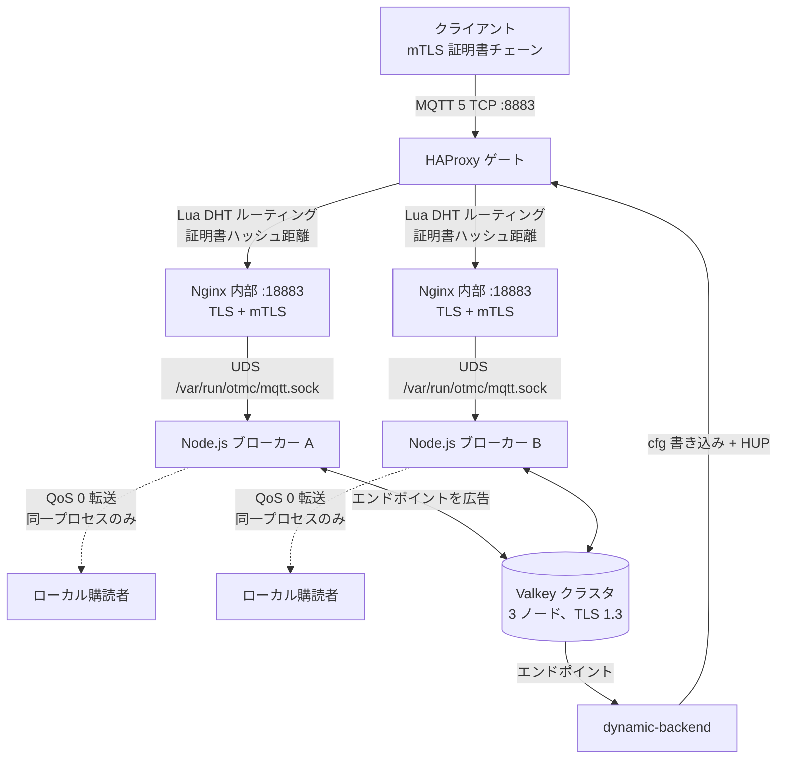

# otmc.broker

OTMC MQTT 5 ブローカーのデプロイ: HAProxy と内部 TLS nginx の背後にある Node.js ブローカーで、サービスディスカバリ用に 3 ノードの Valkey クラスタを使用します。別のダッシュボードスタックがクライアント証明書を発行し、ブラウザ UI を提供します。

> **このドキュメントの状態**
> この README は、`docker-compose.yml`、ダッシュボードの compose ファイル、および `run.x.bash` ヘルパーが実際に起動するスタックを説明しています。以前の README は、計画中の Envoy/QUIC + C++26 Raft アーキテクチャを説明していましたが、その設計はどの compose ファイルからも起動されず、現在のデータパスには実装されていません。古い図は git 履歴で参照できます。

## アーキテクチャ

### データパス



コアサービスは `network_mode: host` を使用するため、上記のポートはホストポートであり、公開されたコンテナポートではありません。

### コンポーネント

| パス | 役割 | 状態 |
| --- | --- | --- |
| `Nodejs_Broker/` | 実際の MQTT 5 サーバー。`mqtt-packet` パケットを直接解析 | 有効 |
| `HAProxy_Gate/` | `:8883` の公開 mTLS イングレス、証明書ハッシュルーティング、バックエンドリロード | 有効 |
| `Nginx_Inner/` | ブローカー UDS への内部 TLS エンドポイント `:18883` | 有効 |
| `ValKey-Cluster/` | ディスカバリと pub/sub 用のホスト別 3 ノード Valkey デプロイ | 有効 |
| `dashboard/` | `:10443` の静的ブラウザ UI と OpenSSL 署名 API | 有効 |
| `CXX_Broker/` | C++26/`async_mqtt` プロトタイプ | プロトタイプ、compose 未組み込み |
| `ProxyWSS/` | WebSocket-to-MQTT ブリッジのプロトタイプ | プロトタイプ、そのままでは実行不可 |
| `test/client_mtls/` | エンドツーエンドの参照 MQTT クライアント | リファレンス |

## リポジトリ構成

```text
Nodejs_Broker/                 MQTT 5 ブローカープロセスと UDS リスナー
HAProxy_Gate/                  HAProxy 設定、Lua ルーティング、動的バックエンド同期
Nginx_Inner/                   ブローカー UDS への TLS ストリームプロキシ
ValKey-Cluster/                ホスト別 Valkey TLS クラスタデプロイ
dashboard/                     nginx + 静的 www + SpaceService
test/client_mtls/              mTLS MQTT 参照クライアント
CXX_Broker/                    C++26 プロトタイプ
ProxyWSS/                      WebSocket ブリッジプロトタイプ
docker-compose.yml             コアイングレススタック
AGENTS.md                      コーディングエージェント向け運用ノート
```

ルートに `package.json` やワークスペースはありません。各サービスは独立したパッケージで、無視対象の `package-lock.json` を持ちます。

## クイックスタート

### 前提条件

- Docker と Compose。
- ホスト上の `/opt/otmc-deploy/otmc.secret/broker/` に証明書があること。これらはコンテナ内の `/usr/local/etc/certs/` にマウントされます。
- 到達可能な Valkey クラスタノード。`Nodejs_Broker/index.mjs` はリッスン開始前に Valkey へ接続するため、クラスタがないとブローカーは終了します。
- Node.js は通常ホストにインストールされていません。必要なマウント付きで `node:26` コンテナを起動する `run.x.bash` ヘルパーを使用してください。

### 1. コアイングレスを起動

```bash
docker compose up -d --build --no-deps haproxy nginx-inner
```

`--no-deps` を使用してください。`haproxy` は `depends_on: mqtt-broker-nodejs` を宣言していますが、コミットされている `mqtt-broker-nodejs` サービスは `Nodejs_Broker/`、`valkey-cluster`、`/dev/shm/otmc` のみをマウントし、クライアント証明書や内部証明書ディレクトリをマウントしないため、即座に終了します。

素の `docker compose up -d` は実行しないでください。壊れている `mqtt-broker-nodejs`、`haproxy-syncbackend`、および古い `valkey` サービスも起動してしまいます。

### 2. ブローカーを起動

```bash
cd Nodejs_Broker
./run.x.bash       # 対話型 node:26 シェル
npm install        # 初回のみ
node index.mjs
```

このヘルパーは 4 つの証明書ディレクトリと `/dev/shm/otmc` をマウントします。`index.mjs` は `/var/run/otmc/mqtt.sock`（ホスト: `/dev/shm/otmc/mqtt.sock`）でリッスンします。

### 3. 動的バックエンドディスカバリを起動

クリーンなチェックアウトには `HAProxy_Gate/backends/empty.cfg` しかありません。ブローカーが Valkey に自身を広告し、`dynamic-backend` が cfg ファイルを書き込むまで、HAProxy には `mqtt_backend_*` ターゲットがありません。

```bash
cd HAProxy_Gate/dynamic-backend
./run.x.bash       # 対話型 node:26 シェル
npm install        # 初回のみ
node index.mjs
```

このヘルパーは `/var/run/docker.sock` と `/usr/bin/docker` をマウントします。新しいバックエンドファイルを書き込んだ後、プロセスが `docker kill -s HUP otmc-haproxy` を実行して HAProxy をリロードするために必要です。compose の `haproxy-syncbackend` サービスには Docker ソケットも CLI もないため、HAProxy をリロードできません。

### 4. ダッシュボードスタックを起動

```bash
docker compose -f dashboard/docker-compose.yml up -d
```

nginx は `dashboard/www` を HTTPS と HTTP/3 で `:10443` 上に提供します。`SpaceService` は起動しません。クライアント証明書ディレクトリへの読み書きアクセスが必要なため、別途起動してください。

```bash
cd dashboard/SpaceService
./run.x.bash       # 対話型 node:26 シェル
npm install        # 初回のみ
npm run dev
```

`openssl x509 -CAcreateserial` が CA シリアルファイルをそこに書き込むため、このヘルパーは `client_cert` を読み書き可能でマウントします。

### 検証コマンド

両方の compose ファイルはパースできます。

```bash
docker compose config -q
docker compose -f dashboard/docker-compose.yml config -q
```

lint、型チェック、CI、自動テストスイートはありません。すべての `npm test` スクリプトは意図的に終了コード 1 を返します。

## 認証

TLS クライアント証明書は `HAProxy_Gate` で終端されますが、それが唯一の認証ステップではありません。MQTT クライアントは MQTT 5 拡張認証も完了する必要があります。

1. クライアントは mTLS で `:8883` に接続します。
2. ブローカーは `CONNECT` に `AUTH` 理由コード `0x18`、メソッド `certchain`、ランダムチャレンジで応答します。
3. クライアントは `authenticationData` が JSON である `AUTH` パケットを送信します。

   ```json
   {
     "cert": "-----BEGIN CERTIFICATE----- ...",
     "challenges": [
       {
         "data": { "challenge": "...", "timeStamp": "2026-11-04T..." },
         "signature": "base64 signature",
         "algorithm": "SHA256",
         "keyAddress": "base58(sha256(spki))"
       }
     ]
   }
   ```

4. ブローカーは `cert` の最初の PEM をリーフとして扱い、チェーンをルート先頭で再構築し、信頼された自己署名ルートを要求し、各リンクと各署名を検証し、現在時刻から 1 分以上ずれたタイムスタンプを拒否します。
5. `keyAddress` は署名者証明書の SPKI DER に対する SHA-256 の Base58 です。チャレンジに実際に署名した鍵だけが署名者として扱われます。

`test/client_mtls/index.js` は参照クライアントです。`mqtt-broker-local10001.wator.xyz:8883` をハードコードし、`./client_cert/{client.space.chain.crt,client-space-leaf.key}` と `./server_cert/server-root.crt` を読み込みます。ホストの証明書ディレクトリをマウントして実行するには `test/client_mtls/tc-lua_client_certs.bash` を使用してください。

### ACL

ブローカーはルート先頭のチェーンに対する `pubKeyHash.slice(-3)` から ACL を構築するため、最も深い 3 つの証明書だけが寄与します。トピックは累積的です。

```text
<h1>/#
<h1>/<h2>/#
<h1>/<h2>/<h3>/#
```

- チャレンジに署名したチェーン証明書にはアクション `all` が付与されます。
- その他の寄与証明書にはアクション `read` が付与されます。
- `write` は決して割り当てられません。したがって、パブリッシュにはその証明書（通常はリーフ）による有効な署名が必要です。
- サブスクリプションは `read` または `all` エントリに一致する必要があります。
- ACL は CONNACK の `userProperties.acl`（JSON）で返されます。

したがって、典型的なトピックは証明書の subject 名ではなく、Base58 公開鍵ハッシュに基づきます。例: `<space-hash>/<room-hash>/#`。

## ルーティングとサービスディスカバリ

- `HAProxy_Gate/haproxy.cfg` は `:::8883` でクライアント mTLS を終端し、`tcp-request content lua.match_backend_by_dht` を実行します。
- `lua/mqtt_route.lua` は提示されたすべての証明書（リーフ先頭、その後は送信されたチェーン）の公開鍵をハッシュし、**最後**のハッシュを取り、最小の XOR 距離を持つ `mqtt_backend_<nodeId>` を選択します。距離はデコードされた Base58 の最初の 8 バイトのみを比較します。
- `Nodejs_Broker/redis_config.mjs` は `internal_cert/internal-server.crt` の SPKI PEM に対する SHA-256 の Base58 として `nodeId` を導出します。同じ値が HAProxy バックエンドのサフィックスおよび Valkey キーのサフィックスになります。
- `Nodejs_Broker/config.mjs` は `config.mqtt`（`host`、`port`）を Valkey に広告します。`HAProxy_Gate/dynamic-backend/` はそれらのレコードを読み、`HAProxy_Gate/backends/mqtt_backend_<nodeId>.cfg` を書き込み、HAProxy をリロードします。
- HAProxy バックエンドファイルが信頼できる情報源です。ランタイム API（`socat ... add backend/server`）で追加されたバックエンドは、次のリロードで失われます。

### 配信は 1 つのブローカープロセス内に限定

`client_session.mjs` はパブリッシュをそのプロセス内の `ClientCollector` と `ClientTopic` マップにのみ転送します。HAProxy はトピックではなく証明書チェーンで接続をルーティングします。異なるブローカープロセスに接続したクライアント同士は互いのメッセージを受信できず、異なるノード間でサブスクリプションは同期されません。

## Valkey

本番ではルート compose の `valkey` サービスではなく、`ValKey-Cluster/` 配下のホスト別 3 デプロイを使用します。各デプロイは別ホスト向けです（3 つすべてが `container_name: valkey-dts` を使用します）。

クラスタは `ValKey-Cluster/REDAME.MD`（ファイル名は誤綴り）の `valkey-cli --cluster create` コマンドで一度だけ作成します。各ノードの `cluster-announce-hostname` はそのディレクトリ/ドメインと一致する必要があります。ノードは `6379` で TLS のみを提供し（`port 0`）、クライアント証明書付き TLS 1.3 を使用します。

ブローカーが使用するキーとチャネル:

| キー / チャネル | 目的 | TTL / 更新 |
| --- | --- | --- |
| `otmc:broker:store:endpoints` | 広告されたブローカーエンドポイントのリスト | 24 時間 / 100 秒 |
| `otmc:broker:store:endpoint:<nodeId>` | ノード別エンドポイント詳細とクライアント数 | 60 秒 / 10 秒 |
| `otmc:broker:endpoint:update` | `dynamic-backend` が消費する pub/sub 通知 | 各更新時 |

ルート compose の `valkey` サービスは古いです。バインド元の `./valkey/valkey.conf` がディレクトリであるため、設定どおりには起動できません。

## 設定とシークレット

- サービスは `/usr/local/etc/certs/{client_cert,server_cert,internal_cert,valkey-cluster}` 配下の絶対パスから証明書を読み込みます。ホスト上ではこれらは `/opt/otmc-deploy/otmc.secret/broker/...` に由来します。
- ダッシュボード nginx は `wator.xyz` 用に `/watorvapor/ecdsa-cert/certbot/etc` も必要とします。
- `Nodejs_Broker/config.mjs` は公開 IPv6 アドレス、Valkey DNS 名、TLS オプション（`rejectUnauthorized: false` を含む）をハードコードしています。環境変数による上書きはありません。
- `HAProxy_Gate/dynamic-backend/config.mjs` は同じ Valkey ホスト/TLS に加え、HAProxy の管理ソケットとバックエンドパスをハードコードしています。
- `config.mqtt` のアドレスは他ノードが `:18883` で接続する先であるため、他ノードから到達可能でなければなりません。

## ダッシュボード

### 静的 UI (`dashboard/www`)

`dashboard/www` はデプロイ済み UI であり、信頼できる情報源です。nginx によって直接提供され、Vite ビルドステップはありません。ページは CDN の Vue と Ant Design Vue を使用した手書きのスタンドアロン HTML です。

- `www/index.html` — MQTT-over-WebSocket ダッシュボード。
- `www/setup/index.html` — ロール選択。
- `www/setup/browser/{leader,follower}/index.html`
- `www/setup/edge/{leader,follower}/index.html`

`www/setup/browser/leader/` は CSR を `POST /api/v1/space/sign/client/space-1st-level` に送信します。他の setup ページはローカルで鍵と CSR を生成し、follower ページはリーフとチェーンを IndexedDB にインポートできます。

メインダッシュボードはデフォルトで `wss://mqtt-browser.wator.xyz:8084/mqtt` に接続します。接続前に IndexedDB から 3 つの証明書とエクスポート不可のリーフ鍵を読み取り、WebSocket サブプロトコルリストに base64url トークンを追加します。

```text
Sec-WebSocket-Protocol: mqtt, auth.<base64url token>
```

トークンには証明書チェーン、タイムスタンプ、クライアント ID、ECDSA P-384/SHA-384 署名が含まれます。**このトークンを実装する WebSocket ゲートウェイはこのリポジトリに存在しません。** `ProxyWSS/` は別のより単純なプロトタイプで（下記参照）、`:8080` でリッスンし、このトークン形式を解析しません。

### 署名 API (`dashboard/SpaceService`)

`SpaceService/server.mjs` は `/var/run/otmc/space.api.sock` でリッスンします。ダッシュボードヘルパーではこれがホストの `/dev/shm/otmc-dashboard` になります。ダッシュボード nginx は `/api/v1/space` を削除した後、`/api/v1/space/*` をこれにプロキシします。

- 存在するプロファイルは `space-1st-level` のみです。
- CSR の CN は `^OTMC-Client_Intermediate_4_Space_1st_level_Cert$` に一致する必要があります。
- `client_cert/client-broker-inter.{crt,key}` と `client-space-top.{ext,srl}` で署名します。
- サービス内の実際のルートは `/sign/client/space-1st-level` です。
- `authenticateBearer` は現在 no-op で `SIGN_TOKEN` は未使用のため、HTTP API には実認証がありません。

## 既知の制限

ブローカープロセス:

- retained メッセージ、永続化、遺言、オフラインセッション、`UNSUBSCRIBE` 処理はありません。
- 転送されるパブリッシュは常に QoS 0 で送信されます。QoS 2 は不完全です。`PUBREC` は送信されますが、`PUBREL`/`PUBCOMP` は処理されません。
- `ClientSession.delete()` は `internal.acl` を参照しますが、これは `AUTH` 成功後にのみ存在します。切断または `AUTH` 失敗したクライアントはソケット close ハンドラから例外を投げ、プロセスを落とす可能性があります。
- `ClientTopic.getSubscriptions()` は完全一致トピックの購読者が存在する場合にその購読者のみを返すため、その場合ワイルドカード購読者がメッセージを取りこぼします。重複するワイルドカードパターンは重複配信を引き起こす可能性もあります。
- `ClientAcl`、`ClientTopic`、`ClientCollector` はモジュールレベルのマップに状態を保存します。別インスタンスがそれを共有します。

HAProxy:

- `dynamic-backend` はバックエンドを追加するだけです。`deleteBackend()` は存在しますが呼び出されません。廃止ノードは `mqtt_backend_*.cfg` を保持し、ファイルが削除されて HAProxy がリロードされるまでルーティング候補として残ります。
- `mqtt_route.lua` の `REDIS_HOST`/`REDIS_PORT` 定数（`127.0.0.1:16379`）は未使用で古いです。ルーティングは現在 `core.backends` にあるバックエンドのみを参照します。
- 生成されたバックエンドファイルは `HAProxy_Gate/backends/.gitignore` で無視されます。コミットしないでください。`empty.cfg` のみを保持してください。
- `haproxy-syncbackend` compose サービスは Docker ソケットも CLI もないため、HAProxy をリロードできません。

テスト:

- `Nodejs_Broker/test/index.mjs` は UDS スモークテストにすぎません。`certchain` AUTH 交換なしで `mqtt+unix:///var/run/otmc/mqtt.sock` に接続するため、成功した CONNACK には到達しません。
- テストディレクトリには独自の `package.json` があります。スクリプトを実行する前にそこで `npm install` を実行してください。

## プロトタイプと計画作業

### `CXX_Broker`

`async_mqtt`、Boost.Asio、Clang モジュールを使用する C++26 MQTT サーバーです。compose からは起動されません。CMake `4.2.0`（`ubuntu:26.04` ビルドイメージを使用）、Boost が必要で、GitHub から `async_mqtt` 10.3.0 を取得します。

```bash
cmake -S CXX_Broker -B build
cmake --build build -j
```

バイナリはハードコードされた `/dev/shm/mqtt/async_mqtt_broker.sock` でリッスンします。`main()` は引数を取らないため、`entrypoint.bash` の `--socket` フラグは無視されます。ルートの `build/` は無視対象の CMake/FetchContent ツリーです。リポジトリのソースとして扱わないでください。

### `ProxyWSS`

ハードコードされたバックエンドリスト、固定の `your-secret-token` チェック、`:8080` リスナーを持つ WebSocket-to-MQTT ブリッジのプロトタイプです。`.mjs` ファイル内で CommonJS の `require` を使用し、`package.json` がないため、コミットされたままでは実行できません。両方の問題を修正せずに compose に組み込まないでください。

### Envoy/QUIC + Raft 設計

以前の README は Envoy/QUIC イングレス、PROXY プロトコル、C++26 ブローカー、Raft ベースのクロスノード同期を説明していました。そのアーキテクチャは依然として設計目標にすぎません。Envoy、C++ ブローカー、Raft サービスを起動する compose ファイルはなく、本番データパスは HAProxy -> nginx -> Node.js ブローカー -> ローカル購読者のままです。

## ライセンス

Peaceful MIT License (PML)。`LICENSE` を参照してください。