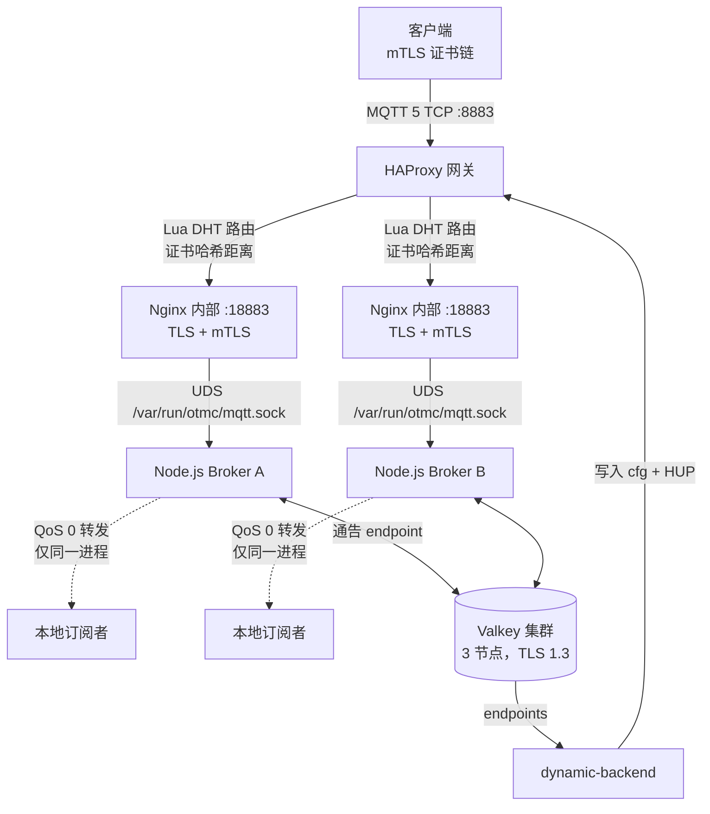

# otmc.broker

OTMC MQTT 5 broker 部署：一个运行在 HAProxy 和内部 TLS nginx 之后的 Node.js broker，并使用三节点 Valkey 集群进行服务发现。另一个 dashboard 栈负责签发客户端证书并提供浏览器 UI。

> **本文档状态**
> 本 README 描述的是 `docker-compose.yml`、dashboard compose 文件以及 `run.x.bash` 辅助脚本实际运行的栈。旧版 README 描述的是计划中的 Envoy/QUIC + C++26 Raft 架构；该设计没有被任何 compose 文件启动，也未在当前数据路径中实现。旧图仍可在 git 历史中查看。

## 架构

### 数据路径



核心服务使用 `network_mode: host`，因此上述端口是主机端口，而不是发布的容器端口。

### 组件

| 路径 | 角色 | 状态 |
| --- | --- | --- |
| `Nodejs_Broker/` | 真正的 MQTT 5 服务器；直接解析 `mqtt-packet` 包 | 活跃 |
| `HAProxy_Gate/` | `:8883` 上的公开 mTLS 入口、证书哈希路由、后端重载 | 活跃 |
| `Nginx_Inner/` | 到 broker UDS 的内部 TLS endpoint `:18883` | 活跃 |
| `ValKey-Cluster/` | 用于发现和 pub/sub 的三套按主机区分的 Valkey 部署 | 活跃 |
| `dashboard/` | `:10443` 上的静态浏览器 UI 加 OpenSSL 签名 API | 活跃 |
| `CXX_Broker/` | C++26/`async_mqtt` 原型 | 原型，未纳入 compose |
| `ProxyWSS/` | WebSocket-to-MQTT 桥接原型 | 原型，按原样不可运行 |
| `test/client_mtls/` | 端到端参考 MQTT 客户端 | 参考 |

## 仓库布局

```text
Nodejs_Broker/                 MQTT 5 broker 进程和 UDS 监听器
HAProxy_Gate/                  HAProxy 配置、Lua 路由、动态后端同步
Nginx_Inner/                   到 broker UDS 的 TLS stream 代理
ValKey-Cluster/                按主机区分的 Valkey TLS 集群部署
dashboard/                     nginx + 静态 www + SpaceService
test/client_mtls/              mTLS MQTT 参考客户端
CXX_Broker/                    C++26 原型
ProxyWSS/                      WebSocket 桥接原型
docker-compose.yml             核心入口栈
AGENTS.md                      面向编码代理的运维说明
```

根目录没有 `package.json` 或 workspace。每个服务都是自己的 package，并带有被忽略的 `package-lock.json`。

## 快速开始

### 先决条件

- Docker 与 Compose。
- 主机上的 `/opt/otmc-deploy/otmc.secret/broker/` 下存在证书。它们会挂载到容器内的 `/usr/local/etc/certs/`。
- 可访问的 Valkey 集群节点。`Nodejs_Broker/index.mjs` 在开始监听之前会连接 Valkey；没有集群时 broker 会退出。
- 主机上通常没有安装 Node.js。请使用 `run.x.bash` 辅助脚本，它会启动一个带有所需挂载的 `node:26` 容器。

### 1. 启动核心入口

```bash
docker compose up -d --build --no-deps haproxy nginx-inner
```

使用 `--no-deps`。`haproxy` 声明了 `depends_on: mqtt-broker-nodejs`，但已提交的 `mqtt-broker-nodejs` 服务只挂载 `Nodejs_Broker/`、`valkey-cluster` 和 `/dev/shm/otmc`；它没有挂载客户端或内部证书目录，因此会立即退出。

不要运行裸的 `docker compose up -d`。它还会启动损坏的 `mqtt-broker-nodejs`、`haproxy-syncbackend` 以及过时的 `valkey` 服务。

### 2. 启动 broker

```bash
cd Nodejs_Broker
./run.x.bash       # 交互式 node:26 shell
npm install        # 仅首次运行
node index.mjs
```

该辅助脚本会挂载全部四个证书目录和 `/dev/shm/otmc`。`index.mjs` 监听 `/var/run/otmc/mqtt.sock`（主机：`/dev/shm/otmc/mqtt.sock`）。

### 3. 启动动态后端发现

干净检出中只有 `HAProxy_Gate/backends/empty.cfg`。在 broker 向 Valkey 通告自身并且 `dynamic-backend` 写入 cfg 文件之前，HAProxy 没有 `mqtt_backend_*` 目标。

```bash
cd HAProxy_Gate/dynamic-backend
./run.x.bash       # 交互式 node:26 shell
npm install        # 仅首次运行
node index.mjs
```

该辅助脚本会挂载 `/var/run/docker.sock` 和 `/usr/bin/docker`；进程在写入新的后端文件后需要运行 `docker kill -s HUP otmc-haproxy` 来重载 HAProxy。compose 的 `haproxy-syncbackend` 服务没有 Docker socket 或 CLI，因此无法重载 HAProxy。

### 4. 启动 dashboard 栈

```bash
docker compose -f dashboard/docker-compose.yml up -d
```

nginx 通过 HTTPS 和 HTTP/3 在 `:10443` 上提供 `dashboard/www`。它不会启动 `SpaceService`；请单独启动它，因为它需要对客户端证书目录的读写访问权限：

```bash
cd dashboard/SpaceService
./run.x.bash       # 交互式 node:26 shell
npm install        # 仅首次运行
npm run dev
```

该辅助脚本以读写方式挂载 `client_cert`，因为 `openssl x509 -CAcreateserial` 会在那里写入 CA serial 文件。

### 验证命令

两个 compose 文件都可以解析：

```bash
docker compose config -q
docker compose -f dashboard/docker-compose.yml config -q
```

没有 lint、类型检查、CI 或自动化测试套件。每个 `npm test` 脚本都故意以退出码 1 结束。

## 认证

TLS 客户端证书在 `HAProxy_Gate` 终止，但它们不是唯一的认证步骤。MQTT 客户端还必须完成 MQTT 5 增强认证：

1. 客户端通过 mTLS 连接到 `:8883`。
2. Broker 对 `CONNECT` 响应 `AUTH` 原因码 `0x18`、方法 `certchain` 和一个随机 challenge。
3. 客户端发送一个 `AUTH` 包，其 `authenticationData` 是 JSON：

   ```json
   {
     "cert": "-----BEGIN CERTIFICATE----- ...",
     "challenges": [
       {
         "data": { "challenge": "...", "timeStamp": "2026-11-04T..." },
         "signature": "base64 signature",
         "algorithm": "SHA256",
         "keyAddress": "base58(sha256(spki))"
       }
     ]
   }
   ```

4. Broker 将 `cert` 中的第一个 PEM 视为 leaf，以 root-first 方式重建链，要求存在受信任的自签名 root，验证每个链接和每个签名，并拒绝与当前时间相差超过一分钟的时间戳。
5. `keyAddress` 是对签名者证书 SPKI DER 做 SHA-256 后的 Base58。只有实际签署了 challenge 的密钥才会被视为签名者。

`test/client_mtls/index.js` 是参考客户端。它硬编码 `mqtt-broker-local10001.wator.xyz:8883`，并读取 `./client_cert/{client.space.chain.crt,client-space-leaf.key}` 以及 `./server_cert/server-root.crt`。使用 `test/client_mtls/tc-lua_client_certs.bash` 在挂载主机证书目录的情况下运行它。

### ACL

Broker 根据 root-first 链上的 `pubKeyHash.slice(-3)` 构建 ACL，因此只有最深的三张证书会参与。Topic 是累积的：

```text
<h1>/#
<h1>/<h2>/#
<h1>/<h2>/<h3>/#
```

- 签署了 challenge 的链上证书获得动作 `all`。
- 其他参与的证书获得动作 `read`。
- 永远不会分配 `write`。因此发布需要由该证书（通常是 leaf）提供有效签名。
- 订阅必须匹配 `read` 或 `all` 条目。
- ACL 在 CONNACK 中以 `userProperties.acl`（JSON）返回。

因此典型 topic 基于 Base58 公钥哈希，例如 `<space-hash>/<room-hash>/#`，而不是证书 subject 名称。

## 路由与服务发现

- `HAProxy_Gate/haproxy.cfg` 在 `:::8883` 上终止客户端 mTLS，并运行 `tcp-request content lua.match_backend_by_dht`。
- `lua/mqtt_route.lua` 对呈现的每张证书（leaf 在前，然后是按发送顺序的链）的公钥做哈希，取**最后一个**哈希，并选择 XOR 距离最小的 `mqtt_backend_<nodeId>`。距离只比较解码后的 Base58 的前八个字节。
- `Nodejs_Broker/redis_config.mjs` 将 `nodeId` 推导为对 `internal_cert/internal-server.crt` 的 SPKI PEM 做 SHA-256 后的 Base58。同一个值也是 HAProxy 后端后缀和 Valkey key 后缀。
- `Nodejs_Broker/config.mjs` 将 `config.mqtt`（`host`、`port`）通告到 Valkey。`HAProxy_Gate/dynamic-backend/` 读取这些记录，写入 `HAProxy_Gate/backends/mqtt_backend_<nodeId>.cfg`，然后重载 HAProxy。
- HAProxy 后端文件是事实来源。通过运行时 API（`socat ... add backend/server`）添加的后端会在下一次重载时丢失。

### 投递局限于单个 broker 进程

`client_session.mjs` 只将发布转发到该进程中的 `ClientCollector` 和 `ClientTopic` 映射。HAProxy 按证书链而不是按 topic 路由连接。落到不同 broker 进程的客户端看不到彼此的消息，不同节点之间也不会同步订阅。

## Valkey

生产使用 `ValKey-Cluster/` 下的三套按主机区分的部署，而不是根 compose 中的 `valkey` 服务。每套部署面向不同主机（三者都使用 `container_name: valkey-dts`）。

使用 `ValKey-Cluster/REDAME.MD`（文件名拼写错误）中的 `valkey-cli --cluster create` 命令一次性创建集群。每个节点的 `cluster-announce-hostname` 必须与其目录/域名匹配。节点只在 `6379` 上提供 TLS（`port 0`），使用 TLS 1.3 和客户端证书。

Broker 使用的 key 和 channel：

| Key / channel | 用途 | TTL / 刷新 |
| --- | --- | --- |
| `otmc:broker:store:endpoints` | 已通告 broker endpoint 列表 | 24 小时 / 100 秒 |
| `otmc:broker:store:endpoint:<nodeId>` | 每节点 endpoint 详情和客户端数量 | 60 秒 / 10 秒 |
| `otmc:broker:endpoint:update` | 由 `dynamic-backend` 消费的 pub/sub 通知 | 每次刷新时 |

根 compose 的 `valkey` 服务已过时：其 bind 源 `./valkey/valkey.conf` 是一个目录，因此无法按配置启动。

## 配置与密钥

- 服务从 `/usr/local/etc/certs/{client_cert,server_cert,internal_cert,valkey-cluster}` 下的绝对路径读取证书。在主机上，这些来自 `/opt/otmc-deploy/otmc.secret/broker/...`。
- Dashboard nginx 还需要 `/watorvapor/ecdsa-cert/certbot/etc` 用于 `wator.xyz`。
- `Nodejs_Broker/config.mjs` 硬编码公网 IPv6 地址、Valkey DNS 名称和 TLS 选项（包括 `rejectUnauthorized: false`）。没有环境变量覆盖。
- `HAProxy_Gate/dynamic-backend/config.mjs` 硬编码相同的 Valkey 主机/TLS，以及 HAProxy 的管理 socket 和后端路径。
- `config.mqtt` 地址是其他节点在 `:18883` 上拨号的目标，因此必须能从其他节点访问。

## Dashboard

### 静态 UI (`dashboard/www`)

`dashboard/www` 是已部署的 UI，也是事实来源。它由 nginx 直接提供；没有 Vite 构建步骤。页面是使用 CDN 上 Vue 和 Ant Design Vue 的手写独立 HTML：

- `www/index.html` — MQTT-over-WebSocket dashboard。
- `www/setup/index.html` — 角色选择。
- `www/setup/browser/{leader,follower}/index.html`
- `www/setup/edge/{leader,follower}/index.html`

`www/setup/browser/leader/` 将 CSR POST 到 `POST /api/v1/space/sign/client/space-1st-level`。其他 setup 页面在本地生成密钥和 CSR，follower 页面可以将 leaf 和链导入 IndexedDB。

主 dashboard 默认连接到 `wss://mqtt-browser.wator.xyz:8084/mqtt`。连接之前，它从 IndexedDB 读取三张证书和一个不可导出的 leaf key，并在 WebSocket 子协议列表中添加一个 base64url token：

```text
Sec-WebSocket-Protocol: mqtt, auth.<base64url token>
```

该 token 包含证书链、时间戳、客户端 ID 以及 ECDSA P-384/SHA-384 签名。**本仓库中不存在实现该 token 的 WebSocket 网关。** `ProxyWSS/` 是另一个更简单的原型（见下文）；它监听 `:8080`，并且不解析该 token 格式。

### 签名 API (`dashboard/SpaceService`)

`SpaceService/server.mjs` 监听 `/var/run/otmc/space.api.sock`；在 dashboard 辅助脚本中，这是主机上的 `/dev/shm/otmc-dashboard`。Dashboard nginx 在剥离 `/api/v1/space` 后将 `/api/v1/space/*` 代理到它。

- 只存在 `space-1st-level` profile。
- CSR CN 必须匹配 `^OTMC-Client_Intermediate_4_Space_1st_level_Cert$`。
- 它使用 `client_cert/client-broker-inter.{crt,key}` 和 `client-space-top.{ext,srl}` 签名。
- 服务内部真实路由是 `/sign/client/space-1st-level`。
- `authenticateBearer` 当前是 no-op，`SIGN_TOKEN` 未使用，因此 HTTP API 没有真正的认证。

## 已知限制

Broker 进程：

- 没有 retained 消息、持久化、will、离线会话或 `UNSUBSCRIBE` 处理。
- 转发的发布始终以 QoS 0 发出。QoS 2 不完整：会发送 `PUBREC`，但从不处理 `PUBREL`/`PUBCOMP`。
- `ClientSession.delete()` 解引用 `internal.acl`，而它只在成功 `AUTH` 后存在。断开连接或 `AUTH` 失败的客户端可能从 socket close handler 抛出异常并导致进程崩溃。
- `ClientTopic.getSubscriptions()` 在存在精确 topic 订阅者时只返回这些订阅者，因此在这种情况下通配符订阅者会漏掉消息。重叠的通配符模式也可能导致重复投递。
- `ClientAcl`、`ClientTopic` 和 `ClientCollector` 将状态存储在模块级映射中。不同实例会共享它。

HAProxy：

- `dynamic-backend` 只添加后端。`deleteBackend()` 存在但从未被调用。已退役节点会保留其 `mqtt_backend_*.cfg`，并在文件被删除且 HAProxy 重载之前继续作为路由候选。
- `mqtt_route.lua` 的 `REDIS_HOST`/`REDIS_PORT` 常量（`127.0.0.1:16379`）未使用且过时。路由只看到当前位于 `core.backends` 中的后端。
- 生成的后端文件被 `HAProxy_Gate/backends/.gitignore` 忽略。绝不要提交它们；只保留 `empty.cfg`。
- `haproxy-syncbackend` compose 服务无法重载 HAProxy，因为它没有 Docker socket 或 CLI。

测试：

- `Nodejs_Broker/test/index.mjs` 只是 UDS 冒烟测试。它连接 `mqtt+unix:///var/run/otmc/mqtt.sock` 时不进行 `certchain` AUTH 交换，因此永远不会到达成功的 CONNACK。
- 测试目录有自己的 `package.json`；运行脚本前先在那里执行 `npm install`。

## 原型与计划工作

### `CXX_Broker`

一个使用 `async_mqtt`、Boost.Asio 和 Clang modules 的 C++26 MQTT 服务器。它不由 compose 启动。它需要 CMake `4.2.0`（使用 `ubuntu:26.04` 构建镜像）、Boost，并从 GitHub 获取 `async_mqtt` 10.3.0：

```bash
cmake -S CXX_Broker -B build
cmake --build build -j
```

二进制监听硬编码的 `/dev/shm/mqtt/async_mqtt_broker.sock`。`main()` 不接受参数，因此 `entrypoint.bash` 中的 `--socket` 标志会被忽略。根 `build/` 是被忽略的 CMake/FetchContent 树；不要将其视为仓库源代码。

### `ProxyWSS`

一个原型 WebSocket-to-MQTT 桥接，带有硬编码后端列表、固定的 `your-secret-token` 检查和 `:8080` 监听器。它在 `.mjs` 文件中使用 CommonJS `require`，并且没有 `package.json`，因此按提交状态不可运行。在修复这两个问题之前，不要将其接入 compose。

### Envoy/QUIC + Raft 设计

旧版 README 记录了 Envoy/QUIC 入口、PROXY protocol、C++26 broker 以及基于 Raft 的跨节点同步。该架构仍然只是设计目标：没有 compose 文件启动 Envoy、C++ broker 或 Raft 服务，生产数据路径仍然是 HAProxy -> nginx -> Node.js broker -> 本地订阅者。

## 许可证

Peaceful MIT License（PML）。见 `LICENSE`。