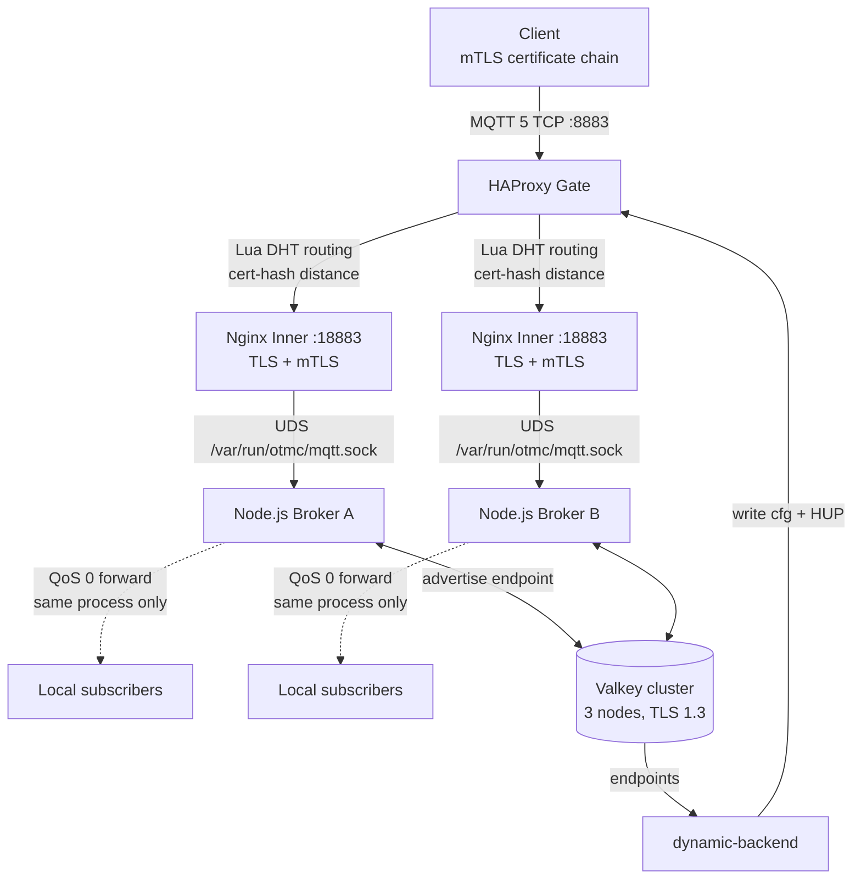

# otmc.broker

OTMC MQTT 5 broker deployment: a Node.js broker behind HAProxy and an internal
TLS nginx, with a three-node Valkey cluster for service discovery. A separate
dashboard stack issues client certificates and serves a browser UI.

> **Status of this document**
> This README describes the stack that `docker-compose.yml`, the dashboard
> compose file, and the `run.x.bash` helpers actually run. The previous README
> described a planned Envoy/QUIC + C++26 Raft architecture; that design is not
> started by any compose file and is not implemented in the current data path.
> The old diagrams remain available in git history.

## Architecture

### Data path



Core services use `network_mode: host`, so the ports above are host ports, not
published container ports.

### Components

| Path | Role | Status |
| --- | --- | --- |
| `Nodejs_Broker/` | Real MQTT 5 server; parses `mqtt-packet` packets directly | Active |
| `HAProxy_Gate/` | Public mTLS ingress on `:8883`, certificate-hash routing, backend reload | Active |
| `Nginx_Inner/` | Internal TLS endpoint on `:18883` to the broker UDS | Active |
| `ValKey-Cluster/` | Three host-specific Valkey deployments for discovery and pub/sub | Active |
| `dashboard/` | Static browser UI on `:10443` plus the OpenSSL signing API | Active |
| `CXX_Broker/` | C++26/`async_mqtt` prototype | Prototype, not in compose |
| `ProxyWSS/` | WebSocket-to-MQTT bridge prototype | Prototype, not runnable as-is |
| `test/client_mtls/` | End-to-end reference MQTT client | Reference |

## Repository layout

```text
Nodejs_Broker/                 MQTT 5 broker process and UDS listener
HAProxy_Gate/                  HAProxy config, Lua routing, dynamic backend sync
Nginx_Inner/                   TLS stream proxy to the broker UDS
ValKey-Cluster/                Per-host Valkey TLS cluster deployments
dashboard/                     nginx + static www + SpaceService
test/client_mtls/              mTLS MQTT reference client
CXX_Broker/                    C++26 prototype
ProxyWSS/                      WebSocket bridge prototype
docker-compose.yml             Core ingress stack
AGENTS.md                      Operational notes for coding agents
```

There is no root `package.json` or workspace. Each service is its own package
and has an ignored `package-lock.json`.

## Quick start

### Prerequisites

- Docker with Compose.
- Certificates at `/opt/otmc-deploy/otmc.secret/broker/` on the host. They are
  mounted into containers at `/usr/local/etc/certs/`.
- Reachable Valkey cluster nodes. `Nodejs_Broker/index.mjs` connects to Valkey
  before it starts listening; without the cluster the broker exits.
- Node.js is usually not installed on the host. Use the `run.x.bash` helpers,
  which start a `node:26` container with the required mounts.

### 1. Start the core ingress

```bash
docker compose up -d --build --no-deps haproxy nginx-inner
```

Use `--no-deps`. `haproxy` declares `depends_on: mqtt-broker-nodejs`, and the
committed `mqtt-broker-nodejs` service only mounts `Nodejs_Broker/`,
`valkey-cluster`, and `/dev/shm/otmc`; it does not mount the client or internal
certificate directories, so it exits immediately.

Do not run a bare `docker compose up -d`. It also starts the broken
`mqtt-broker-nodejs`, `haproxy-syncbackend`, and the stale `valkey` service.

### 2. Start the broker

```bash
cd Nodejs_Broker
./run.x.bash       # interactive node:26 shell
npm install        # first run only
node index.mjs
```

The helper mounts all four certificate directories and `/dev/shm/otmc`.
`index.mjs` listens on `/var/run/otmc/mqtt.sock` (host:
`/dev/shm/otmc/mqtt.sock`).

### 3. Start dynamic backend discovery

A clean checkout only has `HAProxy_Gate/backends/empty.cfg`. HAProxy has no
`mqtt_backend_*` target until the broker has advertised itself in Valkey and
`dynamic-backend` has written cfg files.

```bash
cd HAProxy_Gate/dynamic-backend
./run.x.bash       # interactive node:26 shell
npm install        # first run only
node index.mjs
```

This helper mounts `/var/run/docker.sock` and `/usr/bin/docker`, which the
process needs in order to run `docker kill -s HUP otmc-haproxy` after writing a
new backend file. The compose `haproxy-syncbackend` service has no Docker
socket or CLI and therefore cannot reload HAProxy.

### 4. Start the dashboard stack

```bash
docker compose -f dashboard/docker-compose.yml up -d
```

nginx serves `dashboard/www` over HTTPS and HTTP/3 on `:10443`. It does not
start `SpaceService`; start that separately because it needs read-write access
to the client certificate directory:

```bash
cd dashboard/SpaceService
./run.x.bash       # interactive node:26 shell
npm install        # first run only
npm run dev
```

The helper mounts `client_cert` read-write because
`openssl x509 -CAcreateserial` writes the CA serial file there.

### Validation commands

Both compose files parse:

```bash
docker compose config -q
docker compose -f dashboard/docker-compose.yml config -q
```

There is no lint, typecheck, CI, or automated test suite. Every `npm test`
script intentionally exits 1.

## Authentication

TLS client certificates are terminated at `HAProxy_Gate`, but they are not the
only authentication step. MQTT clients must also complete MQTT 5 enhanced
authentication:

1. Client connects with mTLS to `:8883`.
2. Broker responds to `CONNECT` with `AUTH` reason code `0x18`, method
   `certchain`, and a random challenge.
3. Client sends an `AUTH` packet whose `authenticationData` is JSON:

   ```json
   {
     "cert": "-----BEGIN CERTIFICATE----- ...",
     "challenges": [
       {
         "data": { "challenge": "...", "timeStamp": "2026-11-04T..." },
         "signature": "base64 signature",
         "algorithm": "SHA256",
         "keyAddress": "base58(sha256(spki))"
       }
     ]
   }
   ```

4. The broker treats the first PEM in `cert` as the leaf, rebuilds the chain
   root-first, requires a trusted self-signed root, verifies each link and each
   signature, and rejects timestamps more than one minute from now.
5. `keyAddress` is Base58 of SHA-256 over the signer certificate's SPKI DER.
   Only the keys that actually signed a challenge are treated as the signer.

`test/client_mtls/index.js` is the reference client. It hardcodes
`mqtt-broker-local10001.wator.xyz:8883` and reads
`./client_cert/{client.space.chain.crt,client-space-leaf.key}` plus
`./server_cert/server-root.crt`. Use `test/client_mtls/tc-lua_client_certs.bash`
to run it with the host certificate directories mounted.

### ACLs

The broker builds the ACL from `pubKeyHash.slice(-3)` over the root-first
chain, so only the three deepest certificates contribute. Topics are
cumulative:

```text
<h1>/#
<h1>/<h2>/#
<h1>/<h2>/<h3>/#
```

- A chain certificate that signed the challenge gets action `all`.
- The other contributing certificates get action `read`.
- `write` is never assigned. Publishing therefore requires a valid signature by
  that certificate (normally the leaf).
- Subscriptions must match a `read` or `all` entry.
- The ACL is returned in the CONNACK as `userProperties.acl` (JSON).

Typical topics are therefore based on Base58 public-key hashes, for example
`<space-hash>/<room-hash>/#`, not on certificate subject names.

## Routing and service discovery

- `HAProxy_Gate/haproxy.cfg` terminates client mTLS on `:::8883` and runs
  `tcp-request content lua.match_backend_by_dht`.
- `lua/mqtt_route.lua` hashes the public key of every certificate presented
  (leaf first, then the chain as sent), takes the **last** hash, and selects the
  `mqtt_backend_<nodeId>` with the smallest XOR distance. Distance compares only
  the first eight decoded Base58 bytes.
- `Nodejs_Broker/redis_config.mjs` derives `nodeId` as Base58 of SHA-256 over
  the SPKI PEM of `internal_cert/internal-server.crt`. That same value is the
  HAProxy backend suffix and the Valkey key suffix.
- `Nodejs_Broker/config.mjs` advertises `config.mqtt` (`host`, `port`) into
  Valkey. `HAProxy_Gate/dynamic-backend/` reads those records, writes
  `HAProxy_Gate/backends/mqtt_backend_<nodeId>.cfg`, then reloads HAProxy.
- HAProxy backend files are the source of truth. Backends added through the
  runtime API (`socat ... add backend/server`) are lost on the next reload.

### Delivery is local to one broker process

`client_session.mjs` forwards publishes only to the `ClientCollector` and
`ClientTopic` maps in that process. HAProxy routes a connection by certificate
chain, not by topic. Clients that land on different broker processes do not see
each other's messages, and different nodes do not synchronize subscriptions.

## Valkey

Production uses the three host-specific deployments under `ValKey-Cluster/`,
not the root compose `valkey` service. Each deployment is intended for a
different host (all three use `container_name: valkey-dts`).

Create the cluster once with the `valkey-cli --cluster create` command in
`ValKey-Cluster/REDAME.MD` (the filename is misspelled). Each node's
`cluster-announce-hostname` must match its directory/domain. Nodes serve TLS
only on `6379` (`port 0`), TLS 1.3 with client certificates.

Keys and channels used by the broker:

| Key / channel | Purpose | TTL / refresh |
| --- | --- | --- |
| `otmc:broker:store:endpoints` | List of advertised broker endpoints | 24 h / 100 s |
| `otmc:broker:store:endpoint:<nodeId>` | Per-node endpoint details and client count | 60 s / 10 s |
| `otmc:broker:endpoint:update` | Pub/sub notification consumed by `dynamic-backend` | on each refresh |

The root compose `valkey` service is stale: its bind source
`./valkey/valkey.conf` is a directory, so it cannot start as configured.

## Configuration and secrets

- Services read certificates from absolute paths under
  `/usr/local/etc/certs/{client_cert,server_cert,internal_cert,valkey-cluster}`.
  On the host these come from `/opt/otmc-deploy/otmc.secret/broker/...`.
- Dashboard nginx also needs `/watorvapor/ecdsa-cert/certbot/etc` for
  `wator.xyz`.
- `Nodejs_Broker/config.mjs` hardcodes the public IPv6 address, Valkey DNS
  names, and TLS options (including `rejectUnauthorized: false`). There are no
  environment-variable overrides.
- `HAProxy_Gate/dynamic-backend/config.mjs` hardcodes the same Valkey hosts/TLS
  plus HAProxy's admin socket and backend path.
- The `config.mqtt` address is what other nodes dial on `:18883`, so it must be
  reachable from the other nodes.

## Dashboard

### Static UI (`dashboard/www`)

`dashboard/www` is the deployed UI and the source of truth. It is served
directly by nginx; there is no Vite build step. Pages are hand-written
standalone HTML using Vue and Ant Design Vue from a CDN:

- `www/index.html` — MQTT-over-WebSocket dashboard.
- `www/setup/index.html` — role selection.
- `www/setup/browser/{leader,follower}/index.html`
- `www/setup/edge/{leader,follower}/index.html`

`www/setup/browser/leader/` posts CSRs to
`POST /api/v1/space/sign/client/space-1st-level`. The other setup pages
generate keys and CSRs locally, and the follower pages can import a leaf and
chain into IndexedDB.

The main dashboard connects to `wss://mqtt-browser.wator.xyz:8084/mqtt` by
default. Before connecting, it reads three certificates and a non-exportable
leaf key from IndexedDB and adds a base64url token in the WebSocket subprotocol
list:

```text
Sec-WebSocket-Protocol: mqtt, auth.<base64url token>
```

The token contains the certificate chain, a timestamp, the client ID, and an
ECDSA P-384/SHA-384 signature. **No WebSocket gateway implementing this token
is present in this repository.** `ProxyWSS/` is a different, simpler prototype
(see below); it listens on `:8080` and does not parse this token format.

### Signing API (`dashboard/SpaceService`)

`SpaceService/server.mjs` listens on `/var/run/otmc/space.api.sock`; in the
dashboard helper this is host `/dev/shm/otmc-dashboard`. Dashboard nginx
proxies `/api/v1/space/*` to it after stripping `/api/v1/space`.

- Only the `space-1st-level` profile exists.
- The CSR CN must match
  `^OTMC-Client_Intermediate_4_Space_1st_level_Cert$`.
- It signs with `client_cert/client-broker-inter.{crt,key}` and
  `client-space-top.{ext,srl}`.
- The real route inside the service is `/sign/client/space-1st-level`.
- `authenticateBearer` is currently a no-op and `SIGN_TOKEN` is unused, so the
  HTTP API has no real authentication.

## Known limitations

Broker process:

- No retained messages, persistence, wills, offline sessions, or
  `UNSUBSCRIBE` handling.
- Forwarded publishes always go out at QoS 0. QoS 2 is incomplete: `PUBREC` is
  sent, but `PUBREL`/`PUBCOMP` are never handled.
- `ClientSession.delete()` dereferences `internal.acl`, which only exists after
  a successful `AUTH`. A client that disconnects or fails `AUTH` can throw from
  the socket close handler and take the process down.
- `ClientTopic.getSubscriptions()` returns only exact-topic subscribers when an
  exact subscription exists, so wildcard subscribers miss messages in that
  case. Overlapping wildcard patterns can also deliver duplicates.
- `ClientAcl`, `ClientTopic`, and `ClientCollector` store state in module-level
  maps. Separate instances share it.

HAProxy:

- `dynamic-backend` only adds backends. `deleteBackend()` exists but is never
  called. A decommissioned node keeps its `mqtt_backend_*.cfg` and remains a
  routing candidate until the file is removed and HAProxy is reloaded.
- `mqtt_route.lua`'s `REDIS_HOST`/`REDIS_PORT` constants
  (`127.0.0.1:16379`) are unused and stale. Routing only sees backends currently
  in `core.backends`.
- Generated backend files are ignored by `HAProxy_Gate/backends/.gitignore`.
  Never commit them; keep only `empty.cfg`.
- The `haproxy-syncbackend` compose service cannot reload HAProxy because it has
  no Docker socket or CLI.

Tests:

- `Nodejs_Broker/test/index.mjs` is only a UDS smoke test. It connects to
  `mqtt+unix:///var/run/otmc/mqtt.sock` without the `certchain` AUTH exchange,
  so it never reaches a successful CONNACK.
- The test directories have their own `package.json`; run `npm install` there
  before running the scripts.

## Prototypes and planned work

### `CXX_Broker`

A C++26 MQTT server using `async_mqtt`, Boost.Asio, and Clang modules. It is not
started by compose. It requires CMake `4.2.0` (use the `ubuntu:26.04` build
image), Boost, and fetches `async_mqtt` 10.3.0 from GitHub:

```bash
cmake -S CXX_Broker -B build
cmake --build build -j
```

The binary listens on hardcoded `/dev/shm/mqtt/async_mqtt_broker.sock`.
`main()` takes no arguments, so the `--socket` flag in `entrypoint.bash` is
ignored. Root `build/` is an ignored CMake/FetchContent tree; do not treat it as
repository source.

### `ProxyWSS`

A prototype WebSocket-to-MQTT bridge with a hardcoded backend list, a fixed
`your-secret-token` check, and a `:8080` listener. It uses CommonJS `require`
inside a `.mjs` file and has no `package.json`, so it is not runnable as
committed. Do not wire it into compose without fixing both issues.

### Envoy/QUIC + Raft design

The earlier README documented an Envoy/QUIC ingress, PROXY protocol, C++26
broker, and Raft-based cross-node synchronization. That architecture is still a
design target only: no compose file starts Envoy, the C++ broker, or a Raft
service, and the production data path remains HAProxy -> nginx -> Node.js
broker -> local subscribers.

## License

Peaceful MIT License (PML). See `LICENSE`.
